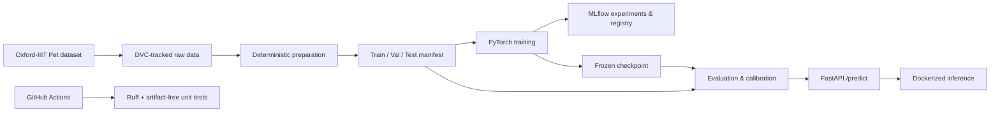

<div align="center">

# 🐾 Pet Breed Classification — MLOps

**From reproducible computer-vision experiments to a tested inference API.**

Classify images of cats and dogs into **37 breeds** using the Oxford-IIIT Pet dataset, with experiment tracking, dataset versioning, model calibration, containerized serving, and automated CI checks.

[](https://github.com/elhamalaa4243/mlops_final_DL_project/actions/workflows/ci.yml)


</div>

---

## Overview

This project demonstrates an end-to-end **MLOps workflow for multi-class image classification**, not just model training. It combines reproducible data preparation, comparative deep-learning experiments, calibrated predictions, model evaluation, API serving, and continuous integration.

**Current status:** Data and evaluation pipelines, model experiments, FastAPI serving, Docker configuration, and GitHub Actions lint/unit-test CI are implemented. Deployment automation, performance optimization, and production monitoring are planned next steps—not yet completed features.

## Results — frozen ResNet-18 baseline

Evaluation on the **3,669-image test split**:

| Metric | Result |
|:--|--:|
| Top-1 accuracy | **87.44%** |
| Macro F1-score | **87.22%** |
| Expected Calibration Error (ECE, before temperature scaling) | **0.0130** |
| Number of classes | **37** |

> These are the recorded results for the frozen `resnet18_v1` baseline, **not** a claim about every trained backbone or a production deployment. See `reports/dvc_metrics.json` and the DVC evaluation stage for reproducibility details. Calibration and selective-prediction behavior should be assessed separately from uncalibrated ECE.

## System architecture



### Technology stack

| Area | Tools |
|:--|:--|
| Deep learning | PyTorch, torchvision |
| Architectures explored | ResNet-18, ResNet-50, MobileNetV3-Small |
| Experiment tracking | MLflow |
| Data & pipeline versioning | DVC |
| Model evaluation | scikit-learn, calibration metrics |
| Inference | FastAPI, Uvicorn, Pillow |
| Containerization | Docker / Compose |
| CI | GitHub Actions, pytest, Ruff |

## Dataset

[Oxford-IIIT Pet](https://www.robots.ox.ac.uk/~vgg/data/pets/) contains **7,349 images** spanning **37 cat and dog breeds**.

| Split | Images |
|:--|--:|
| Train | 2,944 |
| Validation | 736 |
| Test | 3,669 |
| **Total** | **7,349** |

The preparation pipeline uses seed `42` and writes `data/processed/manifest.csv` and `data/processed/classes.json`. Manifest image paths are relative to the repository root for portability. Raw data is DVC-tracked rather than committed to Git.

## Quick start

### Prerequisites

- Python **3.11** recommended (project supports `>=3.11,<3.14`)
- Git
- Sufficient local storage for the dataset and model artifacts
- Docker or Podman if you want to run the container

```bash
# Clone
git clone https://github.com/elhamalaa4243/mlops_final_DL_project.git
cd mlops_final_DL_project

# Create an environment
python3.11 -m venv .venv
source .venv/bin/activate

# Install the package and inference dependencies
python -m pip install -r requirements-serving.txt
python -m pip install -e .
```

> **Artifact availability:** A fresh Git clone does **not** contain the raw dataset, generated manifest, or frozen model checkpoint. The configured DVC remote is local to the original development machine. To reproduce data preparation or run real inference, first make the required artifacts available through an accessible DVC remote or an authorized local copy. The commands below assume those artifacts are present.

### Reproduce the DVC pipeline

Install DVC and the additional data/evaluation dependencies in your environment, then configure an accessible DVC remote before pulling data:

```bash
python -m pip install dvc numpy pandas scikit-learn matplotlib

# Requires an accessible configured DVC remote:
dvc pull

# Reproduce preparation and baseline evaluation:
dvc repro

# Inspect whether outputs are up to date:
dvc status
```

The `dvc.yaml` pipeline contains `prepare` and `evaluate` stages. The evaluation exports a compact metrics summary to `reports/dvc_metrics.json`.

### Run the API locally

With `models/frozen/resnet18_v1.pt`, `models/frozen/calibration.json`, and `data/processed/classes.json` available:

```bash
uvicorn pet_breed.api:app --host 127.0.0.1 --port 8000
```

Open the interactive API documentation at **http://127.0.0.1:8000/docs**.

```bash
# Health check
curl http://127.0.0.1:8000/health

# Predict a pet breed
curl -X POST http://127.0.0.1:8000/predict \
  -F "file=@path/to/pet.jpg"
```

`POST /predict` accepts JPEG/PNG uploads (up to **10 MiB**) and returns the predicted breed, species, confidence, top-three predictions, accept/abstain decision, and model version. Inputs are validated before inference.

### Run with Docker

The repository includes a `Dockerfile` and `compose.yaml`:

```bash
# Build after supplying the required model and classes artifacts
docker build -t pet-breed .

# See compose.yaml for service configuration
docker compose up -d --no-build
docker compose ps
```

The Docker build expects model and metadata files in the build context. **A clean Git checkout alone is not enough to build the inference image.**

## Training and experiment tracking

The project supports **ResNet-18, ResNet-50, and MobileNetV3-Small**. The commands below reproduce short **smoke-test training runs** (one epoch); they are not the full training recipe or a guarantee of the reported baseline metrics.

### Start MLflow

Install MLflow in the active development environment (it is not part of the minimal serving requirements):

```bash
uv pip install mlflow
mlflow --version

mlflow server \
  --backend-store-uri sqlite:///mlflow.db \
  --default-artifact-root ./mlartifacts \
  --host 127.0.0.1 \
  --port 5000
```

Visit **http://127.0.0.1:5000** to inspect runs and logged artifacts. Keep the server running in a separate terminal while training. When using MLflow from another process, configure its tracking URI as needed:

```bash
export MLFLOW_TRACKING_URI=http://127.0.0.1:5000
```

### Train MobileNetV3-Small

```bash
mkdir -p models/experiments

python -m pet_breed.train \
  --backbone mobilenet_v3_small \
  --epochs 1 \
  --batch-size 16 \
  --lr 1e-4 \
  --run-name mobilenet-smoke-test \
  --output models/experiments/mobilenet_smoke.pt
```

### Train ResNet-50

```bash
mkdir -p models/experiments logs
set -o pipefail

python -u -m pet_breed.train \
  --backbone resnet50 \
  --epochs 1 \
  --batch-size 8 \
  --lr 1e-4 \
  --run-name resnet50-smoke-test \
  --output models/experiments/resnet50_smoke.pt \
  2>&1 | tee logs/resnet50_smoke.log
```

These runs require the prepared dataset and training dependencies. The output checkpoints are **experimental** and do not replace `models/frozen/resnet18_v1.pt`.

### Calibrate a trained checkpoint

Calibration uses validation data to fit temperature scaling and a selective-prediction threshold. For example, calibrate ResNet-50:

```bash
python -m pet_breed.calibration \
  --checkpoint models/experiments/resnet50_smoke.pt \
  --classes data/processed/classes.json \
  --manifest data/processed/manifest.csv \
  --output models/experiments/resnet50_calibration.json \
  --report-dir reports/resnet50_smoke \
  --batch-size 16
```

The same workflow can be used for MobileNetV3-Small by changing the checkpoint, output, and report directory:

```bash
python -m pet_breed.calibration \
  --checkpoint models/experiments/mobilenet_smoke.pt \
  --classes data/processed/classes.json \
  --manifest data/processed/manifest.csv \
  --output models/experiments/mobilenet_calibration.json \
  --report-dir reports/mobilenet_smoke \
  --batch-size 16
```

### Log calibration results to an existing MLflow run

Use the **run ID created by your own training run**. Never reuse someone else's example run ID. The following example handles both backbones:

```bash
export MLFLOW_RUN_ID="<your-mlflow-run-id>"
export CALIBRATION_JSON="models/experiments/resnet50_calibration.json"
export CALIBRATION_REPORT_DIR="reports/resnet50_smoke"

python - <<'PYCODE'
import json
import os
from pathlib import Path
import mlflow

run_id = os.environ["MLFLOW_RUN_ID"]
calibration_path = Path(os.environ["CALIBRATION_JSON"])
report_dir = Path(os.environ["CALIBRATION_REPORT_DIR"])
calibration = json.loads(calibration_path.read_text(encoding="utf-8"))
validation = calibration["validation"]

mlflow.set_tracking_uri("http://127.0.0.1:5000")
with mlflow.start_run(run_id=run_id):
    metrics = {
        "val_ece_uncalibrated": validation["ece_before"],
        "val_ece_calibrated": validation["ece_after"],
        "val_nll_uncalibrated": validation["nll_before"],
        "val_nll_calibrated": validation["nll_after"],
        "temperature": calibration["temperature"],
        "threshold": calibration["threshold"],
        "val_coverage": validation["coverage"],
    }
    if validation.get("selective_accuracy") is not None:
        metrics["val_selective_accuracy"] = validation["selective_accuracy"]

    mlflow.log_metrics(metrics)
    mlflow.set_tags({
        "calibration_split": "val",
        "calibration_status": "completed",
        "selective_target_met": str(validation["target_met"]).lower(),
    })
    mlflow.log_artifact(str(calibration_path), artifact_path="calibration")
    if report_dir.is_dir():
        mlflow.log_artifacts(str(report_dir), artifact_path="calibration")

print("Calibration logged to MLflow run:", run_id)
PYCODE
```

To log MobileNetV3-Small calibration, set `MLFLOW_RUN_ID`, `CALIBRATION_JSON`, and `CALIBRATION_REPORT_DIR` to that model's run and artifact paths, then execute the same script.

**Note:** The calibration JSON keys shown above reflect the experiment format used in this project. Check the generated JSON if the calibration implementation changes.

## Testing and continuous integration

The [GitHub Actions workflow](.github/workflows/ci.yml) runs on pushes and pull requests targeting `main`. It installs dependencies, checks Python code with Ruff, and runs unit tests without requiring the large model or dataset artifacts.

```bash
python -m pip install -r requirements-ci.txt
python -m pip install -e .

ruff check src tests scripts
python -m pytest -q -m "not integration"
```

Run the full suite **when local artifacts are available**:

```bash
python -m pytest -q
```

The integration tests cover the real dataset manifest and reference-model logits. They are intentionally excluded from the artifact-free GitHub Actions job. The latest verified local test run passed **11 unit tests and 2 integration tests**; the GitHub Actions unit-test workflow has also passed.

## Project layout

```text
.
├── .github/workflows/ci.yml     # Lint + unit-test CI
├── data/                       # Raw/processed data (DVC-managed)
├── models/frozen/              # Local frozen model + calibration artifacts
├── reports/                    # Evaluation results and metrics
├── scripts/                    # Metrics export utilities
├── src/pet_breed/
│   ├── api.py                   # FastAPI endpoints and startup loading
│   ├── calibration.py           # Calibration and decision thresholding
│   ├── dataset.py               # Dataset utilities
│   ├── evaluate.py              # Model evaluation
│   ├── inference.py             # Prediction pipeline
│   ├── model.py                 # Backbone/model construction
│   ├── prepare_data.py          # Dataset manifest and splits
│   ├── schemas.py               # API response contracts
│   ├── train.py                 # Model training
│   └── transforms.py            # Image preprocessing
├── tests/
│   └── integration/            # Artifact-dependent tests
├── Dockerfile
├── compose.yaml
├── dvc.yaml
├── dvc.lock
├── pyproject.toml
├── requirements-ci.txt
└── requirements-serving.txt
```

## Reproducibility notes

- **Dataset versioning:** DVC tracks the dataset and pipeline dependencies; Git stores DVC metadata, not the image collection.
- **Experiment tracking:** Multiple backbones and training runs were compared with MLflow. ResNet-50 achieved approximately **91.98% validation accuracy** in the recorded experiments; this is **not** the frozen baseline's test accuracy.
- **Evaluation:** The frozen ResNet-18 baseline has a DVC evaluation stage and recorded metrics.
- **Serving:** The API loads a frozen checkpoint and calibration configuration at startup. It is intentionally not model-free in production.
- **CI scope:** GitHub Actions validates code and artifact-independent tests. It does **not yet** re-evaluate checkpoints, publish images, or deploy a service.

## Roadmap

- [x] Deterministic data preparation and dataset manifest
- [x] DVC data and evaluation pipeline
- [x] Train and compare multiple model backbones with MLflow
- [x] Freeze and evaluate a baseline checkpoint
- [x] Calibration-aware FastAPI inference
- [x] Docker and Compose configuration
- [x] GitHub Actions lint and unit-test CI
- [ ] Model quality gates tied to checkpoint/data identity
- [ ] Automated container builds and registry publishing
- [ ] ONNX Runtime / OpenVINO optimization and latency benchmarking
- [ ] BentoML serving and load testing
- [ ] Monitoring, drift detection, and deployment automation

## Acknowledgments

Dataset: [Oxford-IIIT Pet Dataset](https://www.robots.ox.ac.uk/~vgg/data/pets/). Please follow the dataset's original usage and citation guidance when publishing research or derivative work.

---

<div align="center">
  <strong>Built as an end-to-end Deep Learning & MLOps final project.</strong>
</div>
